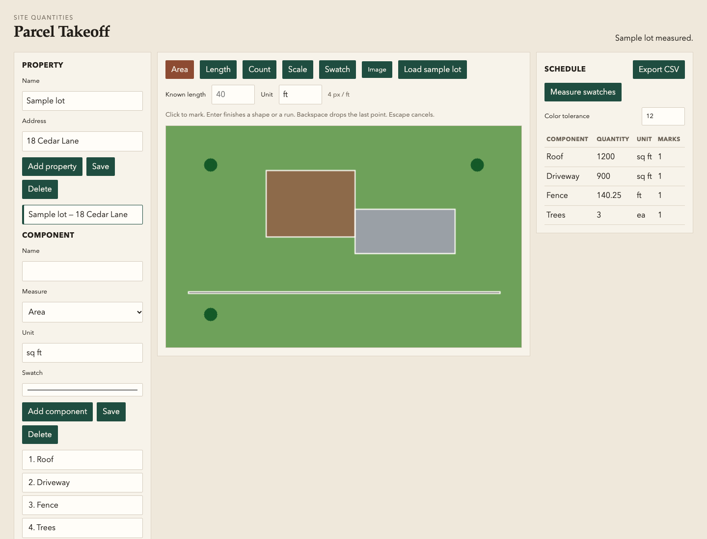

# Parcel Takeoff

Measure a property from a satellite still or a site photo. Name the parts you care about — roof, paving, fence, counted items — set a known length, and the schedule fills in the quantities.

## Run

Node.js 22 or newer.

```bash
node scripts/serve.js
```

Open http://127.0.0.1:4173/web/

On macOS, `scripts/takeoff.command` starts the same server and opens the workspace.

## Download

[Parcel Takeoff 1.0.0](https://github.com/alexalghisi/satelite-property-pics-4k/releases/download/v1.0.0/parcel-takeoff.zip)

Unzip it and run `node scripts/serve.js` from that folder.

## What you see



The sample lot is 160 feet across. At 4 pixels per foot the schedule reads:

| Part | Quantity |
| --- | --- |
| Roof | 1,200 sq ft |
| Driveway | 900 sq ft |
| Fence | 140.25 ft |
| Trees | 3 |

Load your own image the same way. Calibrate with Scale and a known length, mark Area, Length, or Count, or sample a Swatch and measure that color.

## Test

```bash
node --test
node scripts/check.js
```
